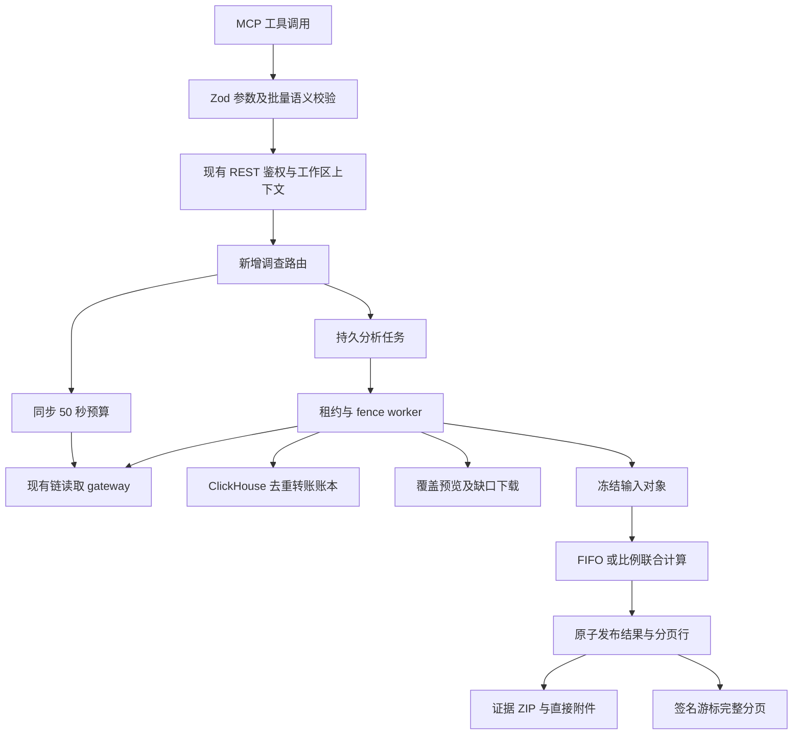
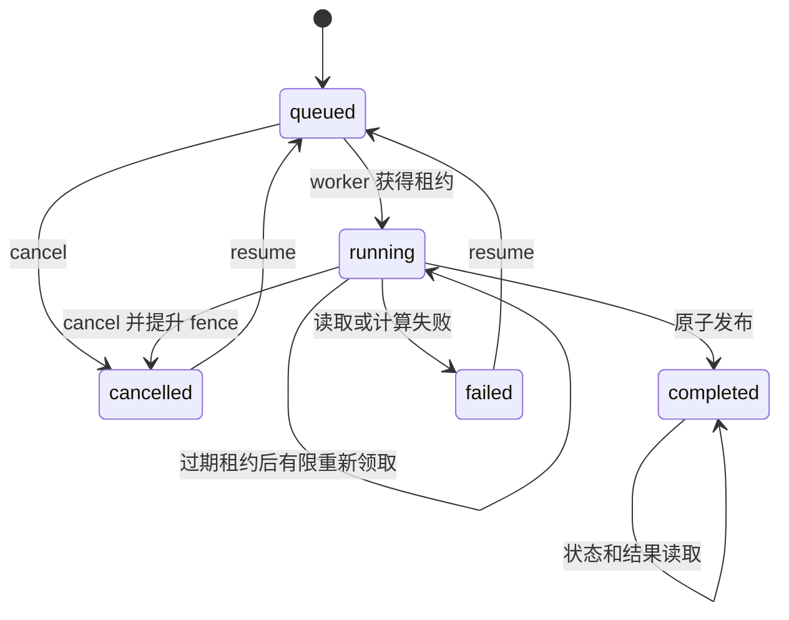

# MCP 链上资金调查：开发、接口、算法与验收手册

> 版本：1.1；日期：2026-10-03；分析器版本：`investigation-v2.1`。  
> 本轮直接扩展现有 `blockchain-platform` 后端和 `blockchain-platform-mcp`，入口沿用 `https://aurore.online/mcp`。  
> 已实现注册表：102 个工具，其中本轮新增 20 个单项工具及 5 个专用批量工具；资源模板由 1 个增至 2 个。  
> 本文描述实际实现。正式部署结果以同目录归档的 `investigation/next-stage/deployment-verification.json` 为准；有代码、有测试、已部署是三个不同状态。  
> 较早的《下一阶段开发规范》保留目标设计；与本手册存在差异时，本手册用于调用当前实现，草案用于安排后续开发。

## 目录

1. 目标与交付边界
2. 与现有 77 个工具的关系
3. 源码架构及数据流
4. 通用参数、响应与金额契约
5. 状态快照与时间语义
6. 新增接口和批量注册表
7. 账本对账及缺口补齐
8. 多笔源资金联合归因
9. Case B 的复现与判读
10. 交易级资金解释
11. CCTP V1 跨链关联
12. 实际授权余额
13. 控制权历史
14. 持久异步分析
15. 全量分页及持久游标
16. 可直接读取的证据包
17. 地址和权限监控
18. PostgreSQL 迁移及对象存储
19. 权限、工作区隔离和凭据
20. 预算、缓存和性能
21. 错误处理及恢复
22. 测试矩阵和验收证据
23. 发布、并发修改保护及回滚
24. 常用调查工作流
25. 已知边界、后续任务和参考资料

## 1. 目标与交付边界

本轮解决八类调查问题：账本是否与实际余额相符、多筆源资金是否被重复归因、复杂交易有哪些实际资金移动、跨链消息是否有协议证据、当前授权到底还有多少、任务能否持久运行、证据能否直接读取，以及后续余额和控制权变化如何记录。

### 1.1 功能状态

| 功能 | 当前实现 | 重要边界 |
|---|---|---|
| 对账 | ERC20 开闭区块 RPC 状态与索引转账核对 | 标准 Transfer 账本；非标准余额变化可能产生差额 |
| 缺口补齐 | 调用既有下载系统获取覆盖缺口 | 补齐后必须发起新的对账；不会修改旧快照 |
| 联合归因 | 同链同币种、最多 100 个源事件；FIFO 与比例同时返回 | 所选源批次发生重叠时拒绝；有限图范围不代表全部后续历史 |
| 交易解释 | ERC20 事件、成功原生币调用、逐资产转账净额、gas | 转账净额不是精确逐交易存储差额；trace 和 ABI 缺失明确返回 |
| 跨链关联 | 注册链上的 CCTP V1，两端回执和消息字段匹配 | 调用者需提供两端完整交易哈希；不自动搜索目标交易 |
| 授权 | 固定快照的真实 ERC20 allowance；可在有限区间发现 spender | Permit2、NFT、operator 等授权须另行适配 |
| 控制历史 | 标准事件和区间两端控制状态 | 无日志、自定义角色、区块内瞬时状态不能自动证明完整 |
| 异步分析 | PostgreSQL 租约、取消、恢复、不可变输入和结果 | 联合归因及对账保存输入检查点；分配算法从检查点重新运行 |
| 证据包 | 确定性 ZIP、SHA256 清单、MCP 直接分块附件 | 文件完整性不等于链数据或归因结论正确 |
| 监控 | 确认区块快照比较、规则修订、内部事件箱 | 轮询之间的短暂变化可能遗漏；默认暂停，无外部通知 |

### 1.2 三类结论必须分开

1. **链上事实**：区块、交易、成功回执、日志、固定区块状态读取。
2. **模型结果**：在 FIFO 或比例假设下分配给源批次的数量。
3. **现实实体判断**：地址标签、交易所归属和控制关系的证据强度。

守恒通过只说明会计分配没有创造源资金。不能据此证明这些可替代代币的物理身份，也不能直接推导交易所账户实名信息。

## 2. 与现有 77 个工具的关系

### 2.1 继续使用现有入口

无需新建独立 MCP。新增工具与余额、RPC、ABI、聚合、地址标签、CEX 路径和导出工具使用同一注册表、REST 客户端、鉴权和 provider gateway。

| 已有能力 | 本轮复用方式 |
|---|---|
| `get_native_balance` / `get_token_balance` | 获取实际状态余额；保留 `balance_source`、`as_of_block`、`is_current_balance` |
| `get_balance_at` / `get_balance_history` | 指定时间点定位和历史样本读取 |
| `get_all_token_balances` / 余额批量 | 既有资产发现及同快照分页 |
| `read_rpc`、`eth_*` | 使用安全只读白名单；固定区块读取走 archive 路由 |
| ABI、日志和输入解码 | 交易解释、权限事件与桥事件复用解码基础 |
| `trace_funds` / `trace_fund_batch` | 单源模式继续保留；联合源使用新的共享账本 |
| `aggregate_transfers` | 保留服务端全量汇总、完整地址统计及游标分页 |
| `ensure_chain_data` 系列 | 对账修复复用覆盖预览、缺口下载与任务重试 |
| `get_export_file` / `download_export` | 原有 `export://` 资源继续可读 |
| 控制权、代理和标签 | 作为历史边界状态和监控探测的基础 |

### 2.2 不混淆独立批量与联合分析

`batch_get_balances` 查询多个地址，结果互相独立。`trace_source_set` 则把多个源放入**同一本账**：所有源共同竞争同一条实际出金的可分配金额。分别运行两个单源模型，再将其结果相加，不具备这个约束。

## 3. 源码架构及数据流

服务器仓库：`/home/euripides/projects/blockchain-platform`。



### 3.1 模块责任

| 文件 | 职责 |
|---|---|
| `backend/internal/api/investigation_next.go` | 请求结构、验证、20 条路由、同步/异步分派、能力说明 |
| `investigation_next_ledger.go` | 对账、源回执核验、联合输入提取及分配结果 |
| `investigation_next_reads.go` | 授权、控制历史、交易解释和成功 trace 资金腿 |
| `investigation_next_bridge.go` | CCTP V1 注册表、消息解析、两端协议核验 |
| `investigation_next_jobs.go` | 幂等提交、租约、fence、输入检查点、结果发布及分页 |
| `investigation_next_bundle.go` | ZIP 生成、受限读取、SHA/CRC/条目清单校验 |
| `investigation_next_watch.go` | 规则 CRUD、修订、租约评估、确认快照及内部事件 |
| `backend/internal/fundtrace/joint.go` | 与 HTTP/数据库无关的共享账本分配器 |
| `backend/internal/query/investigation.go` | 去重流水、区间过滤和写入时间截止条件 |
| `backend/internal/provider/rpc/{gateway,batch,health}.go` | 修复合约回滚误触发 provider 熔断的问题 |
| `backend/cmd/api/main.go` | 将调查 workers 绑定 API 生命周期 |
| `mcp/src/next-investigation.ts` | 新工具 schema、描述、REST 路径和本地语义验证 |
| `mcp/src/batch.ts` | 专用别名、全部单项工具通用批量、昂贵操作并发控制 |
| `mcp/src/investigation.ts` | 新增 `evidence://` 资源模板与鉴权读取 |

### 3.2 启动约定

正常 API 启动会启动调查分析和监控 worker。standby 模式默认关闭这些循环。隔离验收可显式设置 `INVESTIGATION_WORKER_ENABLE=1`，只开启本轮 worker，不恢复原有下载调度等 standby 禁用的循环。

worker 使用数据库租约竞争任务，因此多 API 实例不会仅靠进程内标记判断所有权。结果发布仍必须检查未过期租约、当前 fence 和任务状态。

## 4. 通用参数、响应与金额契约

### 4.1 请求格式

REST 请求使用 JSON 对象。后端严格拒绝未知字段、多个串联 JSON 对象、超出 2 MiB 的请求体。MCP schema 还会在发出 HTTP 之前校验所需字段。

链名在服务器规范化，Ethereum 的内部 slug 为 `eth`。MCP 输入链枚举包括 `ethereum`、`bsc`、`polygon`、`arbitrum`、`optimism`、`base`、`avalanche`。某项协议支持的链集合可能小于一般 EVM 操作集合。

完整 EVM 地址为 `0x` 加 40 位十六进制字符，交易哈希为 `0x` 加 64 位。截断地址和 `0xd94c…` 只能用于文字展示，不能成为查询参数。

### 4.2 精度

| 字段类别 | 传输类型 | 处理方式 |
|---|---|---|
| `amount_raw` / `balance_raw` / `allowance_raw` | 十进制整数字符串 | Go `big.Int`；JS 读取时使用 `BigInt` |
| 显示金额 | 十进制字符串或未知时 null | 根据实际 decimals 格式化，不经过 float |
| 差额、资金净额 | 有符号整数字符串 | 可为负数，不能套用 uint256 输入验证 |
| 输入的源金额 | 无符号 uint256 字符串 | 仅数字、至多 78 位、实际 BitLen 不超过 256 |
| 区块/分页数量 | JSON 数值 | MCP 限制在 JS 安全整数范围内 |
| 未读取或读取失败的余额 | null/错误状态 | 不替换为 `"0"` |

不根据 token symbol 推测 decimals。BSC 官方 USDT 在本次 Case B 中使用 18 位精度：`16770180000000000000000` 对应 `16770.18`。

### 4.3 同步和异步参数

六个计算型工具使用顶层字段：

```json
{
  "mode": "async",
  "idempotency_key": "investigation-case-b-run-001"
}
```

- `mode` 默认为 `inline`；只支持 `inline` 和 `async`。
- 当前没有嵌套 `execution` 对象、`auto` 模式或 `wait_ms`。
- `inline` 超时或结果过大不会悄悄创建后台任务。
- `async` 返回任务 ID，客户端再读取状态和结果。
- 幂等键可选；调查自动化建议明确提供，最多 128 字符。
- 不能将同一幂等键用于两个不同语义请求。

### 4.4 响应外壳

沿用现有 REST `success/data/error/meta` 外壳，MCP 在 `structuredContent` 中保留结构化结果。以 `data` 内的操作专属完整性字段为准；通用 meta 的 coverage 不会替操作做“全部完整”保证。

每个计算型接口保留实际证据、限制原因和状态信息。客户端应显示这些状态，不能只提取漂亮的金额字段而丢弃不完整标记。

## 5. 状态快照与时间语义

### 5.1 三类状态

1. 不指定时间/区块：读取并固定当前状态点。
2. 指定 `block`：查询该区块的状态。
3. 指定 `timestamp`：定位不晚于该时间的最后一个区块，再读取该区块状态。

`block` 可使用区块整数、十进制/十六进制字符串或支持的 block tag。`timestamp` 必须是带时区的 RFC3339 时间。两者互斥。对账和联合归因还可使用 `to_block` 明确终点。

### 5.2 状态点字段

```json
{
  "as_of_block": 106243602,
  "as_of_block_hash": "<实际区块哈希>",
  "as_of_time": "<实际区块 UTC 时间>",
  "is_current_balance": false
}
```

固定历史区块即使是 RPC 读取，仍然 `is_current_balance=false`。历史净流入属于账本计算，不能伪装成当前余额。

### 5.3 重组检查

在冻结输入和使用已有检查点时，关键边界区块会重新读取，使用 `ConsistencyForceRefresh` 绕过已有区块缓存。如果区块号相同而哈希改变，返回 `SNAPSHOT_REORG`，要求创建新分析。

检查边界、源事件区块及快照哈希提高可复核性；这并不是逐条索引流水的独立节点共识证明。

## 6. 新增接口和批量注册表

### 6.1 20 个单项工具

下表的 REST 路径均以 `/api/v1` 为前缀，方法全部为 POST。

| MCP 名称 | REST 后缀 | 主要输入 | 主要输出 |
|---|---|---|---|
| `get_investigation_capabilities` | `/analysis/get_investigation_capabilities` | chain | 操作、模型、协议、预算、限制 |
| `reconcile_address_ledger` | `/analysis/reconcile_address_ledger` | address/token/from_block/终点 | 开闭余额、差额、覆盖、逐笔证据 |
| `trace_source_set` | `/analysis/trace_source_set` | token/sources/终点 | 两模型、逐源守恒、共享边、地址和证据 |
| `explain_transaction` | `/analysis/explain_transaction` | tx_hash/include_trace | 资金腿、gas、逐资产净额、解码与缺口 |
| `match_bridge_transfer` | `/analysis/match_bridge_transfer` | 源链/哈希、目标链/哈希、protocol | 协议字段、mint、消息及核验强度 |
| `get_token_allowances` | `/analysis/get_token_allowances` | owner/token/spenders 或 discovery 区间 | 实际 allowance、快照、逐项错误 |
| `get_control_history` | `/analysis/get_control_history` | contract/from_block/to_block | 标准事件、边界状态和完整性 |
| `start_analysis` | `/analysis/start_analysis` | operation/arguments/idempotency_key | analysis_id/queued/固定边界 |
| `get_analysis_status` | `/analysis/get_analysis_status` | analysis_id | 状态、阶段、版本、SHA、错误和元数据 |
| `get_analysis_results` | `/analysis/get_analysis_results` | analysis_id/section/page_size/cursor | 完整结果行、总数、下一页游标 |
| `cancel_analysis` | `/analysis/cancel_analysis` | analysis_id | 当前取消/完成状态 |
| `resume_analysis` | `/analysis/resume_analysis` | analysis_id | 恢复入队或明确拒绝原因 |
| `create_evidence_bundle` | `/export/create_evidence_bundle` | analysis_id | bundle_id、SHA、文件大小 |
| `get_evidence_bundle` | `/export/get_evidence_bundle` | bundle_id/offset/chunk_size | MCP 附件字节、chunk SHA、next_offset |
| `verify_evidence_bundle` | `/export/verify_evidence_bundle` | bundle_id | ZIP 与条目完整性报告 |
| `create_watch_rule` | `/analysis/create_watch_rule` | 规则参数 | rule_id/revision/state |
| `list_watch_rules` | `/analysis/list_watch_rules` | state/page_size/cursor | 规则页及实际基线区块/哈希 |
| `update_watch_rule` | `/analysis/update_watch_rule` | rule_id/expected_revision/完整配置 | 新修订并重置基线 |
| `set_watch_rule_state` | `/analysis/set_watch_rule_state` | rule_id/expected_revision/state | 乐观并发检查后的状态 |
| `get_watch_events` | `/analysis/get_watch_events` | rule_id?/page_size/cursor | 事件页、next_cursor、tail_cursor |

### 6.2 五个专用批量

| 工具 | 数组字段 | 单项操作 |
|---|---|---|
| `batch_reconcile_address_ledgers` | addresses | reconcile_address_ledger |
| `batch_get_token_allowances` | addresses | get_token_allowances |
| `batch_get_control_history` | addresses | get_control_history |
| `batch_explain_transactions` | tx_hashes | explain_transaction |
| `batch_match_bridge_transfers` | tx_hashes | match_bridge_transfer |

每个专用批量最多 200 项。共同参数写在顶层，每个结果保留输入索引、地址/哈希、成功状态、完整 REST 响应或错误。

跨链批量别名共享顶层目标参数；如果每个源对应不同目标哈希，使用 `batch_call_tools` 的独立 arguments，不能将一个目标交易套给所有源。

### 6.3 通用批量

全部 20 个新增单项工具纳入 `batch_call_tools`，最多 20 项，禁止嵌套批量。结构及可本地判断的语义先全部验证，随后才能执行先前的写入项。

```json
{
  "requests": [
    {
      "tool": "get_token_allowances",
      "arguments": {
        "chain": "bsc",
        "address": "0x467a4c89ff241e3bde8de50d0a8f999c4a8a4d7f",
        "token_contract": "0x55d398326f99059ff775485246999027b3197955",
        "spenders": ["0x10ed43c718714eb63d5aa57b78b54704e256024e"],
        "block": 106243602
      }
    },
    {
      "tool": "get_investigation_capabilities",
      "arguments": {"chain": "bsc"}
    }
  ],
  "max_concurrent": 2
}
```

上例中的字段应以 `tools/list` schema 为准。混合 batch 不应因为一项链上读取失败而丢掉其他成功结果。对创建型操作，应主动提供幂等键或使用规则修订检查。

## 7. 账本对账及缺口补齐

### 7.1 数学定义

给定地址 A、精确 token T、闭区间 `[S,E]`：

```text
opening = RPC.balanceOf(A, S-1)
closing = RPC.balanceOf(A, E)
incoming = Σ Transfer(T, to=A, block∈[S,E])
outgoing = Σ Transfer(T, from=A, block∈[S,E])
expected = opening + incoming - outgoing
difference = closing - expected
```

自转账对余额净变化为零。地址零值代表 mint/burn 参与方，并不意味着存在可支配的零地址普通余额。

### 7.2 调用示例

```json
{
  "chain": "bsc",
  "address": "0x467a4c89ff241e3bde8de50d0a8f999c4a8a4d7f",
  "token_contract": "0x55d398326f99059ff775485246999027b3197955",
  "from_block": 106243602,
  "to_block": 106243750,
  "max_records": 20000,
  "repair": false,
  "mode": "inline"
}
```

### 7.3 字段判读

| 字段 | 含义 |
|---|---|
| opening_balance / closing_balance | 真实边界状态，含原始余额、来源和状态点 |
| incoming_raw / outgoing_raw | 当前保留流水的整数总额 |
| expected_balance_raw | 从开余额和流水计算的理论闭余额 |
| difference_raw | 有符号精确差额 |
| record_count | 保留的去重流水数 |
| amounts_complete | 未触发流水条数预算 |
| ledger_complete | 未截断且覆盖预览满足全部所需区间 |
| balanced | difference_raw 为零 |
| reconciled | balanced 与 ledger_complete 同时成立 |
| evidence | 完整保留的逐笔流水，可异步分页 |
| source_ingested_before | 索引写入时间截止点 |
| data_cutoff_block/hash | 链数据终点 |
| snapshot_id | 冻结输入内容哈希 |

覆盖完整检查使用各项准确块数和 gaps，不能因为浮点覆盖率四舍五入到 100% 就判完整。差额为零也不能排除等额入出流水同时缺失。

### 7.4 repair 流程

`repair=true` 在覆盖不完整时调用已有 `Ensure` 下载缺口。结果包含修复任务信息及 `repair_requires_fresh_reconciliation=true`。调用者应等待下载完成，再提交**新的**对账；旧结果及其 SHA 不被重写。

覆盖已经完整但仍有差额时，不自动扫描全部历史。可能原因包括索引错误、rebase、非标准 Transfer 行为和特殊余额机制，应按明确区间和协议证据继续诊断。

### 7.5 范围边界

本版不提供通用原生币对账。原生币完整对账需要纳入交易手续费、内部执行、链专属费用、奖励及系统余额变化，不能机械套 ERC20 公式。

## 8. 多笔源资金联合归因

### 8.1 选择源事件

每个 source 包含交易哈希、日志索引、可选 source_id 和可选 amount_raw。服务器核验成功回执、精确 token emitter、Transfer 结构、接收地址及实际数量。

- 一笔交易可能包含多个同币种 Transfer；明确 `log_index` 最容易复核。
- 可选择源事件中的部分金额，但不能超过实际事件金额。
- 重复选择同一事件不能制造第二份源资金。
- 每个源只在其实际日志位置激活，较晚的源不能归因到较早出金。
- 全部 sources 必须属于同一链、同一精确 token contract。

### 8.2 共享账本

联合输入从最早源区块前一块建立基线，使用统一终点和写入时间截止点。按 `(block, log_index, tx_hash)` 排序，以交易哈希和日志索引去重。

相关图地址的历史余额用于未标记基线。外部入账仍保留逐笔明细，但不会为了每个无关外部付款人读取历史余额：外部未标记资金不属于所选源批次。

如果已标记资金进入没有可靠基线、且不在已展开范围的地址，记入明确 frontier。不会继续猜测该地址的所有历史出金都属于所选源资金。

### 8.3 FIFO

所有余额片段按到达顺序消费。只有相邻的未标记片段可合并，避免改变标记资金与其他资金的先后顺序。不同 source_id 始终保留独立身份。

FIFO 的结果代表该顺序假设，不代表链上 token 真有序号。多个批次的合计消费仍不得超出实际出金。

### 8.4 比例模型

在每次实际支出时，对该地址的所有物理余额片段统一做整数比例分配。舍入使用最大余数方法和稳定顺序补足最小单位，不能对每个源独立向上取整。

假设某地址已有 100 单位未标记资金、源 B1 20、源 B2 30，实际支出 15：总池 150，理想分配为未标记 10、B1 2、B2 3。三部分总和必须恰为 15。

极大整数也走同一方法；不会因为超过 JS 的 `2^53` 而转换成浮点。

### 8.5 两层守恒

**每条边：**

```text
Σ attributed_by_source_raw == total_attributed_raw
total_attributed_raw <= transfer.amount_raw
```

**每个源：**

```text
Σ remaining_attributed_raw
+ burned_raw
+ unexpanded_frontier_raw
== seed_amount_raw
```

`accounted_amount_raw` 必须等于 `seed_amount_raw`。不能把累计经过边的金额当作源资金总量，因为同一资金可以多次流转。

### 8.6 重叠源

如果第二个被选源事件已经消费了第一源的已标记资金，重新将其标记成全新的第二源会重复计数。本版明确返回 `SOURCE_OVERLAP`，要求调整源事件集合。不会默默把一个源拆掉，也不会将同一物理金额同时属于两份新增种子。

### 8.7 不完整及异常

缺口、记录预算、节点/跳数边界和未解释余额缺口分别保留限制信息。存在这些情况时，计算仍可展示有界模型结果，但 `complete=false`。

守恒成立和 `complete=false` 可以同时出现。这说明当前保留账本上的分配守恒，尚未证明覆盖了全部相关历史。

## 9. Case B 的复现与判读

### 9.1 固定样本

- 链：BSC。
- token：`0x55d398326f99059ff775485246999027b3197955`。
- 源地址：`0x467a4c89ff241e3bde8de50d0a8f999c4a8a4d7f`。
- 混合资金地址：`0xd94c9f6119948b15f9000d77a8938ce13d952675`。
- 两地址之间全部 6 笔历史转账合计 `79163.6899` USDT。
- `min_amount=10000` 路径条件选中 2 笔，合计 `65729.7883` USDT。

| 源 | 完整交易哈希 | 日志索引 | 区块 | amount_raw | 显示金额 |
|---|---|---:|---:|---|---|
| B1 | `0x01a18187b7e235f404d2dfb661ca637c7e5d78d1dec8435e0f7c5bc2dc0371f0` | 111 | 102994266 | `16770180000000000000000` | `16770.18` |
| B2 | `0x9d6cfe5b7750e7ed71ce34fe6ccda2513623f32d824bb48c5326827dd88d9346` | 454 | 106243602 | `48959608300000000000000` | `48959.6083` |

### 9.2 完整提交示例

```json
{
  "operation": "trace_source_set",
  "idempotency_key": "case-b-joint-001",
  "arguments": {
    "chain": "bsc",
    "token_contract": "0x55d398326f99059ff775485246999027b3197955",
    "sources": [
      {"tx_hash": "0x01a18187b7e235f404d2dfb661ca637c7e5d78d1dec8435e0f7c5bc2dc0371f0", "log_index": 111, "source_id": "B1"},
      {"tx_hash": "0x9d6cfe5b7750e7ed71ce34fe6ccda2513623f32d824bb48c5326827dd88d9346", "log_index": 454, "source_id": "B2"}
    ],
    "to_block": 106243750,
    "max_records": 20000,
    "max_nodes": 30,
    "max_hops": 1,
    "attribution_model": "both"
  }
}
```

此示例给 `start_analysis`。直接调用 `trace_source_set` 时移除外层 operation/arguments，将上述 arguments 加上 `mode="async"` 和幂等键。

### 9.3 验收观察

隔离验收保留 918 条逐笔证据、两模型合计 42 条归因边、13 条模型/源/地址余额记录。两个模型均通过逐源守恒和每条实际边的金额上限。

总种子原始金额是 `65729788300000000000000`。混合地址其他数百万 USDT 历史出金不得加入这个种子总量。

该测试只展开一跳，并且覆盖存在缺口，因而 `complete=false`。这些数量是这份有界快照的结果，不是声称整个混合地址历史只有 918 笔，也不是全部下游都调查完毕。

## 10. 交易级资金解释

### 10.1 调用

```json
{
  "chain": "bsc",
  "tx_hash": "0x9d6cfe5b7750e7ed71ce34fe6ccda2513623f32d824bb48c5326827dd88d9346",
  "include_trace": true,
  "mode": "inline"
}
```

### 10.2 资金腿分类

| 来源 | 计入条件 | 排除条件 |
|---|---|---|
| ERC20 Transfer | 成功回执、正确日志结构和 emitter | 失败交易、移除日志、ERC721 等不同结构 |
| 根交易 value | 已确认成功；与 trace 根值避免重复 | 失败交易、重复根资金腿 |
| CALL | 正数量、调用成功、全部祖先成功 | 父调用最终回滚 |
| CREATE / CREATE2 | 成功创建时实际 value | 回滚创建 |
| SELFDESTRUCT | trace 能证明受益地址和数值 | 缺失或不可信 trace 数据 |
| DELEGATECALL / STATICCALL | 不作为原生币资金腿 | 它们的 value 字段不代表独立 value 转账 |

整笔交易失败时，执行期间日志和 value 变化不能作为最终到账。gas 费用独立处理。

### 10.3 gas 和净额

基本执行费用使用精确整数 `gasUsed × effectiveGasPrice`。资金腿按资产和地址汇总有符号转账净额。不同 token 的原始单位互不相加。

当前 gas 字段不自动包含全部 rollup L1 费、blob 费和链专属附加费用。客户端不能把它称为所有链的完整交易总成本。

### 10.4 解码和 trace 失败

输入解码复用既有 ABI 服务。未知 ABI 不阻止返回原始资金腿。trace 不可用时，可返回已经确认的日志和根交易 value，但保留 trace 缺口。

当前没有通用 DEX swap、LP mint/burn、包装币、桥、闪电贷等全部协议动作语义适配器。完整资金腿是协议解释的基础，不应把几个相邻 Transfer 自动命名为完整交换路径。

## 11. CCTP V1 跨链关联

### 11.1 支持范围

当前仅 `protocol="cctp_v1"`；Ethereum、Avalanche、Optimism、Arbitrum、Base、Polygon 主网。BSC 不在本适配器注册表中。

调用者提供源和目标完整交易哈希。金额与时间接近不能代替协议匹配。CCTP V2 使用独立消息版本及适配器，不能套用 V1 解析。

### 11.2 核验顺序

1. 获取两端交易、成功回执及规范区块。
2. 源 `MessageSent(bytes)` 必须由官方注册 MessageTransmitter 发出。
3. V1 消息及 burn body 版本必须正确，消息长度为适配器支持的 248 字节。
4. source/destination domain 必须与注册链一致。
5. sender/recipient 必须是对应链注册 TokenMessenger。
6. 目标 `MessageReceived` emitter、source domain、nonce、sender 和完整 body 必须一致。
7. 同一区段内目标 TokenMessenger 的 `MintAndWithdraw` 必须匹配 mint recipient 和精确整数金额。
8. 若目标交易直接调用 `receiveMessage`，再比较 calldata 内的原始 message 字节。
9. 核验两端规范区块哈希。

匹配目标事件时使用对应 MessageReceived 的日志区段，不能把同一交易其他消息的 mint 拿来凑金额。

### 11.3 证据强度

消息字段匹配和原始消息字节匹配分开返回。合约嵌套调用且顶层 calldata 不直接暴露 receiveMessage 时，不能声称已验证完整原始消息字节。

`MessageSent` 可能来自 replacement message，本版不会仅凭它声称发生了新的源端 burn；`source_burn_verified` 保持明确限制。目标成功接收和 mint 证明的内容也不能扩展为现实身份结论。

### 11.4 验证边界

适配器已用构造的正确 V1 消息、伪 emitter、错误 nonce、错误 mint 和畸形 ABI 进行回归测试。本轮没有使用一对真实 CCTP 两端主网交易完成正向验收，因此“支持适配器”与“真实链对端到端验收”必须区分。

## 12. 实际授权余额

### 12.1 明确 spender

```json
{
  "chain": "bsc",
  "address": "0x467a4c89ff241e3bde8de50d0a8f999c4a8a4d7f",
  "token_contract": "0x55d398326f99059ff775485246999027b3197955",
  "spenders": ["0x10ed43c718714eb63d5aa57b78b54704e256024e"],
  "block": 106243602
}
```

服务器对每个 spender 实际执行 `allowance(owner,spender)`，共享同一固定状态点。每项成功或失败独立返回，`allowance_raw` 为字符串，不能把读取失败当作 0。

### 12.2 Approval 发现

`discover=true` 需要明确 `from_block` 与 `to_block`，区间最多 100,000 块。标准 Approval 日志用于发现候选 spender，最后仍按查询快照读取实际 allowance。

发现区间外、更早的 spender、自定义授权、permit 结构以及缺失日志不在“发现完整”保证中。历史 Approval 的 amount 可能已经消耗或撤销，不能直接报告成当前剩余额度。

### 12.3 额度和资产存量

allowance 是 spender 可执行转移的授权上限，实际可动用量还受余额、合约条件、黑白名单、暂停机制和 token 实现约束。无限授权也不是证明该 spender 已经转走资产。

## 13. 控制权历史

输入固定区块区间，最多 100,000 块。读取标准 OwnershipTransferred、AdminChanged、Upgraded、RoleGranted/Revoked、Paused/Unpaused 等事件，并获取两端控制状态。

### 13.1 两个完整性层次

- `event_range_complete`：支持事件在请求区间内的有界日志扫描是否完成。
- `control_history_complete`：是否能证明全部控制变化；本版对于自定义/静默/区块内变化不作完整保证。

即使事件扫描成功，也不能把 `control_history_complete` 自动设为 true。

### 13.2 历史边界

区块状态属于该区块结束后的状态。仅靠区块两端 storage 不能恢复一笔交易中“升级后马上降回”的中间状态。角色是否可枚举、代理类型是否识别和 ABI 是否可获取，也会影响解释能力。

### 13.3 与现有控制分析配合

现有 `get_contract_control` 提供 deployer、owner/admin、proxy、implementation、signers、角色和权限线索。本轮历史工具用于时间维度扩展；监控使用更轻的标准控制探测，避免每次轮询执行所有 ABI 权限猜测。

## 14. 持久异步分析

### 14.1 六种 operation

`start_analysis` 只接受：reconcile_address_ledger、trace_source_set、explain_transaction、match_bridge_transfer、get_token_allowances、get_control_history。arguments 必须通过该 operation 的完整校验。

### 14.2 状态机



### 14.3 幂等和动态快照

语义请求哈希在把 `latest` 固定成当前区块**之前**生成。同一工作区、同一幂等键和同一原始语义请求会复用任务；不会因为第二次调用时链头前进而发生错误冲突。

不同参数复用相同键返回 `IDEMPOTENCY_CONFLICT`。数据库工作区 advisory lock 与唯一约束共同保证并发提交不创建两份。

### 14.4 租约参数

| 参数 | 当前值 |
|---|---:|
| 分析轮询周期 | 2 秒 |
| 任务租约 | 30 秒 |
| 心跳 | 2 秒 |
| worker 单次计算时限 | 300 秒 |
| 过期租约自动领取尝试上限 | 3 次 |
| 工作区 queued/running 上限 | 20 |

显式 resume 也检查活动队列上限。不能通过先取消再恢复来绕过容量控制。

### 14.5 检查点

联合归因和对账将实际账本、状态余额、覆盖、截止时间及区块哈希写入对象存储，保存 SHA256。恢复时验证对象字节哈希与规范区块，再从冻结输入运行计算。

当前没有逐转账保存分配器的内存状态，也没有任意任务的通用永久状态快照。其他读取类分析恢复时可能需要重读证据；文案会明确检查点范围。

### 14.6 取消与 stale worker

取消提升 fence、清空租约并修改任务状态。旧 worker 即使稍后返回结果，也无法通过 publish 的状态/fence/租约检查。

已经完成的任务不会被 cancel 删除。失败/取消任务可在版本相同情况下恢复；版本改变时要求使用正确版本或创建新任务。

### 14.7 可见结果

完整结果对象和分页行只在成功完成后原子可见。当前不暴露运行中的 append-only 部分结果页。`get_analysis_results` 对未完成任务返回 `ANALYSIS_NOT_COMPLETED`。

## 15. 全量分页及持久游标

### 15.1 section

先通过 `get_analysis_status` 读取 `metadata.sections`，再选择 section。典型值包括 evidence、edges、addresses、events、allowances、funds_legs。它们按实际结果生成，不能假定每类 operation 都包含全部 section。

未知 section 返回 `UNKNOWN_RESULT_SECTION`；不会将拼错名称伪装成“查到 0 条”。

### 15.2 分页约定

```json
{
  "analysis_id": "<实际 UUID>",
  "section": "evidence",
  "page_size": 100,
  "cursor": "<上一页 next_cursor>"
}
```

第一页面不带 cursor。默认 100、最大 500 行，同时限制页内结果字节为 4 MiB。`record_count` 是这个 section 的全部记录数，`items` 是当前页。

继续读取直到 `next_cursor=null`。不存在“只返回前 200 名”的分页截断。分析输入的资源预算仍然独立存在；全量分页是指**已保留且已发布快照中的全部行**。

### 15.3 签名绑定

分析游标绑定 analysis ID、section、结果 SHA、最后 ordinal，并使用该任务数据库保存的随机密钥做 HMAC。访问任务本身还需通过工作区权限检查。

因此，游标不能换任务、换 section 或换结果使用，API 重启不会生成新密钥使旧页失效。当前没有游标过期和 key ID 轮换协议；如果增加保留期策略，应同时定义过期错误及数据清理流程。

### 15.4 地址行

联合结果地址行包含 model、source_id、address、attributed_balance_raw。它报告该模型下当前保留账本终点的源批次余量；不代替地址整体真实 RPC 余额。

多个模型中的同一地址是不同分析行。客户端应按 model/source分组后展示，不能将两种模型结果相加。

## 16. 可直接读取的证据包

### 16.1 ZIP 内容

| 条目 | 内容 |
|---|---|
| request.json | 已验证并保存的请求和固定参数 |
| input.json | 已保存的实际输入检查点；没有检查点的 operation 可不包含 |
| result.json | 完整计算结果，含逐笔证据和限制 |
| manifest.json | 版本、operation、请求哈希、各条目长度及 SHA256 |

相同输入文件使用固定 ZIP 时间、稳定条目顺序和确定性压缩生成。对象及数据库保存整个 archive SHA。manifest 不递归声明自身哈希。

### 16.2 读取步骤

1. 完成分析，调用 `create_evidence_bundle`。
2. 保存 bundle_id、sha256、size_bytes。
3. 调用 `get_evidence_bundle`，从 MCP embedded resource 的 blob 读取字节。
4. 校验 chunk_sha256，按 next_offset 继续。
5. 可用 `resources/read` 读取 `evidence://<bundle_id>/<offset>/<chunk_size>`。
6. 重组后校验整体 SHA 和字节长度。
7. 调用 `verify_evidence_bundle` 校验服务器保存对象。

分块默认 1 MiB，最大 4 MiB。它返回真实附件字节，不要求调用者访问公网下载链接。

### 16.3 安全与完整性

验证过程限制 archive 大小、解压总量、单条目大小和允许的文件名，拒绝重复条目、缺失必须条目、CRC 错误、SHA/长度不符。

当前证据包上限 32 MiB。不是任意 zip 解压服务，不接受外部 URL，也不允许 ZIP path traversal 写入任意路径。

### 16.4 可复核的范围

冻结输入可以复核联合分配和对账的计算材料。当前不是每一个 RPC 原始响应的完整审计仓库，也没有交付通用离线重放命令行工具。manifest 的内容哈希不证明第三方 provider 从未返回错误数据。

## 17. 地址和权限监控

### 17.1 规则类型

| rule_type | 观察内容 | 额外参数 |
|---|---|---|
| balance_change | 原生币或指定 ERC20 状态余额 | token_contract 可选 |
| allowance_change | 指定 spender 的实际 allowance | 必须提供 token_contract 和 spenders |
| control_change | 标准控制字段和已识别代理信息 | 合约 address |

默认 state 为 paused。调用者显式设置 active 或通过状态工具激活后，worker 才开始评估。

### 17.2 示例

```json
{
  "chain": "bsc",
  "address": "0x467a4c89ff241e3bde8de50d0a8f999c4a8a4d7f",
  "token_contract": "0x55d398326f99059ff775485246999027b3197955",
  "name": "Case B 源地址余额变化",
  "rule_type": "balance_change",
  "interval_seconds": 300,
  "confirmations": 12,
  "state": "paused"
}
```

`interval_seconds` 范围 60–86400，默认 300。confirmations 范围 2–1000，默认 12。工作区启用/暂停规则合计最多 100，禁用后重新启用仍检查容量。

### 17.3 修订及并发

更新和状态变更需 expected_revision。修订过旧返回 `WATCH_REVISION_CONFLICT`。配置更新重置基线；从暂停或禁用重新激活也重新建立基线，以免把暂停期间的所有差异冒充实时变化。

状态变化清除 worker 租约。旧修订计算不得写入新修订结果。相同 state 的幂等调用不额外增加修订。

### 17.4 第一轮及读取失败

首轮成功读取只建立基线，不凭空创建余额变化事件。规则列表暴露 last_snapshot_block、last_snapshot_hash 与 last_error，便于证明确实完成过读取。

RPC/代理解析不完整时保留旧基线，记录读取不可用。未知 owner 不能被误改成已撤销 owner，从而产生错误警报。

### 17.5 确认和重组

每次使用 `head-confirmations` 的固定状态点。对已有基线哈希做新读取核对；不再属于规范链时写入 `reorg_baseline_replaced`，并显式指出旧快照需撤回。

这是两个已确认快照的比较。它不会逐块覆盖所有转账/授权/控制变更，余额离开又回到原值的短暂变化可能在轮询之间消失。

### 17.6 控制监控

轻量探测包括 owner、admin、proxy_admin、proxy_admin_owner、implementation、beacon、multisig signers 和 threshold。标准 selector 的合约回滚意味着该探测不可用，不计入 provider 网络故障。

自定义 privileged roles 和权限函数需要现有完整控制分析或新增 adapter；轻量监控并不声称枚举所有控制路径。

### 17.7 内部事件读取

`get_watch_events` 使用工作区、规则过滤和持久签名的 sequence keyset。next_cursor 用于当前多页，tail_cursor 用于之后轮询新增事件。

规则及事件列表是 live keyset 视图，不是分析结果那样的不可变快照。不会发送邮件、短信、Webhook 或外部 IM 消息。

## 18. PostgreSQL 迁移及对象存储

迁移文件：`backend/migrations/postgres/0081_investigation_next.sql`。

### 18.1 表

| 表 | 核心内容 |
|---|---|
| investigation_analysis_jobs | 工作区、operation/version/request/hash、幂等键、状态、fence、lease、input/result object及SHA、持久cursor key |
| investigation_analysis_rows | analysis_id/section/ordinal 主键，JSONB 行数据 |
| investigation_evidence_bundles | 工作区、analysis_id、对象路径、archive SHA、大小及清单 |
| investigation_watch_rules | sequence、规则配置、revision、state、周期、确认、基线及lease |
| investigation_watch_events | sequence、rule/revision、工作区、唯一event_key、kind及data |
| investigation_workspace_cursors | 工作区列表游标的持久 HMAC 密钥 |

### 18.2 权限

迁移赋予正常 application role 所需的 SELECT/INSERT/UPDATE/DELETE 和 sequence 使用权。worker 使用应用角色操作，不要求运行时 DDL、TRUNCATE 或超级用户权限。

集成测试在随机 UUID 命名 schema 中执行迁移并 `SET ROLE blockchain_app`，测试结束仅删除自己创建的 schema；不会把生产业务表当测试 fixture。

### 18.3 对象布局

分析对象路径由服务器工作区和 analysis ID 生成，例如：

```text
investigation/<organization>/<workspace>/<analysis>/input-<sha>.json
investigation/<organization>/<workspace>/<analysis>/result-<sha>.json
```

调用者不能直接提交任意对象路径读取。文件访问先查询归属，再读取对应对象并验证 SHA。

### 18.4 迁移兼容性

本迁移是新增表，不修改旧 77 工具依赖的数据结构。发布期间发现另一个改动占用了 0080 迁移编号后，迁移改为 0081，并对既有运行时重新建立基线。

回滚 API/MCP 时保留新增表。未经明确数据清理方案，不删除已完成调查证据和用户规则。

## 19. 权限、工作区隔离和凭据

沿用现有 read/analysis/export scope 映射。证据包走 export 权限；六个可异步计算的工具与规则写入走 analysis，包括 `get_token_allowances`，避免只有 read 权限也能通过 `mode=async` 创建任务；能力、状态及规则/事件读取走 read。当前没有新增独立 watch_manage/watch_read scope。

### 19.1 资源归属

analysis、bundle、rule、event 的 organization/workspace 来自服务端上下文，客户端不能选择别人的租户。worker 从已领取数据库行恢复同一上下文。

读取和变更资源都加入工作区条件。另一个工作区知道 UUID 仍不能读取。分页行查询在先验证任务归属后执行。

### 19.2 现有 API key 模式

平台既有 Actions API key 配置使用服务器默认工作区。数据库支持 scope 隔离，并不意味着本轮已经实现每个 MCP API key 对应独立租户的全新认证体系。若需要多团队分区，应扩展现有鉴权映射，再做 API key 到租户的端到端测试。

### 19.3 凭据处理

链 provider 凭据只存在服务器配置。客户端不传 provider URL。验收脚本读取现有服务环境但不输出 secret，不将数据库 DSN 或 API key 放在进程命令行、文档或测试报告。

## 20. 预算、缓存和性能

### 20.1 当前硬边界

| 资源 | 当前上限/行为 |
|---|---|
| REST 请求体 | 2 MiB |
| 同步处理 | 50 秒 |
| 同步结果 JSON | 8 MiB；超限要求 async |
| async 输入/结果对象 | 32 MiB |
| 结果页 | 500 行及 4 MiB |
| source set | 100 个 source |
| 联合输入流水 | 20,000；分配器自身保护 20,001 |
| 图节点 | 100 |
| hops | 5 |
| allowance spender | 200 |
| 控制/发现区间 | 100,000 块 |
| 日志读取窗口 | 初始最多 2,000 块，并使用现有自适应读取 |
| 专用 batch | 200 项 |
| 混合 batch | 20 项 |
| 昂贵 batch 实际并发 | 2 |
| 普通 batch 最大并发 | 8 |
| batch 时间预算 | REST 单次时限与 50 秒取小值 |
| MCP 文件分块 | 默认 1 MiB，最多 4 MiB |
| ZIP 构建/校验并发门 | 2 |

### 20.2 联合计算保护

每模型还有 2,000,000 工作单位、50,000 活动片段和 100,000 消耗审计保护。取消检查位于计算循环中，避免高扇出账本无限运行。

async 延长请求之外的执行生命周期，但不等于无限扫描。大于预算的调查应拆分范围或继续开发更大的持久分区处理方案。

### 20.3 历史余额读取收窄

真实 Case B 首次联合查询发现：为全部无关历史入账付款人读取 archive 基线会快速触发账户预算。实现改为只给已展开、可能持有并继续消费已标记源资金的发送地址读取基线。外部普通入账仍保存，不能被删除来“优化”账本。

当缺少必要基线时标记 frontier/错误，绝不以 0 替代已标记地址的未知历史余额。

### 20.4 熔断 bug 修复

原 gateway 将任意调用错误记为 provider failure。控制权探测经常调用不存在的 owner/admin/角色 selector，合约正常回滚累计后使整个链 eth_call 熔断，真实余额读取受影响。

修复将有效的合约回滚、参数拒绝和能力拒绝识别为 provider 已正常响应。原错误仍返回、仍计入方法错误指标；provider 可达性画像与业务调用成功分开判断。超时、限流、上游错误和无效响应保留故障计数。

新增回归用例连续执行 40 次回滚探测，随后正常余额 eth_call 必须成功。

### 20.5 缓存边界

使用既有 gateway 的固定区块缓存和路由能力。规范哈希检查显式 force refresh。不会由业务模块绕过 gateway 私接 RPC URL。

## 21. 错误处理及恢复

### 21.1 常见错误

| 代码 | 含义 | 调查客户端处理 |
|---|---|---|
| IDEMPOTENCY_CONFLICT | 相同键对应不同语义请求 | 改用新键，保留原调查记录 |
| ANALYSIS_QUEUE_FULL | 工作区 20 个活动任务 | 等待、取消无用任务后重试 |
| ANALYSIS_NOT_FOUND | 当前工作区不可见任务 | 检查 ID、权限和归属 |
| ANALYSIS_NOT_COMPLETED | 未原子发布结果 | 继续查状态 |
| ANALYSIS_NOT_RESUMABLE | 当前状态不能恢复 | 获取最新状态 |
| ANALYSIS_VERSION_CHANGED | 与原处理器版本不符 | 使用原版本或新建任务 |
| SNAPSHOT_REORG | 固定区块哈希发生变化 | 新建快照，不沿用旧结果 |
| SOURCE_OVERLAP | 新源包含先前已标记资金 | 调整源集合，防止重复种子 |
| SOURCE_LEDGER_CONFLICT | 索引源与回执不符 | 保留冲突证据并修复数据 |
| ALLOCATION_BUDGET_EXCEEDED | 分配工作超预算 | 缩小范围或增加分区能力 |
| INLINE_RESULT_TOO_LARGE | 同步结果超过 8 MiB | async +结果页 |
| RESULT_BUDGET_EXCEEDED | 持久结果超过 32 MiB | 拆范围或实现大型对象分片 |
| RESULT_ROW_TOO_LARGE | 单行超过 4 MiB | 需要进一步拆分该类型数据 |
| UNKNOWN_RESULT_SECTION | section 不在 metadata.sections | 使用可用 section |
| WATCH_REVISION_CONFLICT | 规则修订不匹配 | 先读最新 revision |
| WATCH_RULE_LIMIT | 工作区启用/暂停规则达 100 | 禁用无用规则后重试 |
| RPC_* | 标准化 provider 错误 | 按其能力/预算/临时故障类别处理 |

错误具体 HTTP 状态和文案以实现为准。游标签名/绑定错误及普通参数错误使用现有参数错误响应，不伪装成空成功页。

### 21.2 重试策略

gateway 自身处理有限退避和 provider failover。合约回滚、非法参数、archive 不支持和额度超限不应盲目不断重试。

分析 worker 的自动重领用于过期租约和进程恢复。普通业务失败会保留错误并进入 failed；服务恢复后可显式 resume。worker 不会无限占用 provider 请求配额。

### 21.3 未知不是零

未知 allowance、缺失 trace、控制字段探测不可用、缺失 archive 和覆盖缺口都保留独立状态。错误路径不得填 0/空数组并宣布“无资产、无权限、无转账”。

## 22. 测试矩阵和验收证据

### 22.1 纯计算测试

| 类别 | 核验 |
|---|---|
| 联合 FIFO/比例 | 共享池、逐源守恒、每边合计上限 |
| 时间激活 | 较晚 source 不影响其之前出金 |
| 最大余数 | 大整数及稳定整数舍入 |
| 重复/重叠源 | 不重复造种子，明确拒绝 |
| frontier/burn | 源余额从活动池移出后仍守恒 |
| 外部大量入账 | 未标记百万资金不膨胀 10 单位源种子 |
| 取消和预算 | 计算可中断，超预算明确报错 |
| trace | 父回滚抑制子资金，delegate/static 不算 value 转账 |
| CCTP | 正确消息、伪 emitter、nonce/mint 错误、畸形动态 ABI |
| ZIP | 确定性、内容篡改、长度/清单、受限条目 |
| 游标 | 跨任务/section/SHA及签名篡改被拒绝 |
| 熔断 | 40 次合法回滚后正常 eth_call 仍成功 |

### 22.2 PostgreSQL 集成测试

在 UUID schema、应用角色下验证：工作区隔离、幂等冲突、取消恢复、1001 条高精度数据完整分页、取消后的旧 fence 无法发布、恢复不能绕过队列上限、规则重新启用不能绕过容量，以及未知 section 拒绝。

1001 行分页使用 137 行页大小，检查每个 ordinal 恰好一次，没有前 200/1000 行限制。

### 22.3 MCP 测试

`npm run check` 执行 TypeScript/build/tests：102 工具顺序、readOnly 注解、五个别名、全部新增单项通用 batch、嵌套语义错误在早先写入前拒绝、附件鉴权和 SHA 校验等。

### 22.4 真实链读取

| 场景 | 已观察结果 |
|---|---|
| 历史 allowance | 指定区块 106243602 的实际 RPC 字符串值 |
| 对账 | 106243602–106243750，3 条流水，difference_raw=0，完整且 reconciled |
| 交易解释 | Case B 第二源官方 USDT 48959.6083 及独立 gas |
| 控制历史 | 有界区间、两端状态、事件完整但总体历史不作完整保证 |
| 联合 Case B | 两源 65729.7883，两模型守恒及每边上限 |
| 证据包 | 直接附件与 resources/read 重组、整体 SHA及成员校验 |
| 规则 | paused 创建、修订冲突、激活后真实建立基线且无虚假事件、最终 disabled |
| 老接口 | 当前/历史余额、完整聚合页、ABI、单源模型、批量错误、原有导出附件及标签 |

### 22.5 报告文件

本地归档目录：`C:/Users/Euripides/Documents/ChatGPT/ubuntu/investigation/next-stage`。

- `final-checks.json`：后端、race、PG、MCP 检查返回码。
- `next-verification.json`：新功能真实调用及 Case B。
- `existing-verification.json`：原有接口回归。
- `extra-verification.json`：新增 batch、取消恢复、API 重启后的旧游标和证据包。
- `migration-verification.json`：迁移名称、SHA 和结果。
- `deployment-verification.json`：运行二进制/注册表/发布结果。
- `case-b-evidence.zip`：实际完整证据包。
- `changes.json` 和 `candidate-source-sha.json`：交付文件与哈希。

只有对应报告存在且通过的项才算完成。合成桥测试不冒充真实跨链正向验收；快照轮询测试不冒充所有区块全覆盖监控。

## 23. 发布、并发修改保护及回滚

### 23.1 隔离候选

本轮候选目录为仓库 `.work/mcp-next-20261003`，API 8089、MCP 8099。正式 API 8080、MCP 8090 在验收期间继续运行。

候选使用完整源副本进行 build，不能从本地仅归档的一小部分文件重建服务器完整应用。测试使用实际配置但凭据不写报告。

### 23.2 并发修改

部署前比较：既有源文件 SHA、新文件不存在条件、构建源码集合、正式 API 二进制 SHA、全部 MCP dist 文件 SHA，以及候选已验收源 SHA。

开发中确实遇到另一组下载恢复改动并已重新合并基线。保留其新增源和运行时，不 reset、不覆盖 dirty 工作区，不假定整个仓库只有本轮修改。

任何重叠改动需要先检查差异、合并并重新测试。不能仅删除 guard 让部署继续。

### 23.3 发布门

1. 后端及 MCP 检查通过；PG 集成与 race 通过。
2. 新/旧真实功能报告通过。
3. 迁移记录与源 SHA 正确。
4. 没有正在执行的导出和调查任务需要被中断。
5. 核对正式代码及运行时没有再次发生并发更新。
6. 备份旧 API、dist 及既有修改文件。
7. 原子替换候选文件和二进制，切换完整 dist。
8. 停止候选 worker，重启正式服务，检查健康、102 注册工具和 2 个资源模板。
9. 从正式入口读取历史余额、已完成分析页和证据包；记录新运行 SHA。

### 23.4 回滚

健康或实际功能验证失败时恢复旧 API/dist 和改动前源文件，删除本轮新源文件，但不删除调查数据表。重新启动并记录回滚健康状态。

不要清理原有 source 或未归档用户文件。临时脚本清理只限本轮明确创建的文件。

## 24. 常用调查工作流

### 24.1 钱现在还在不在

先读取当前 RPC 余额，再用具体时间/区块余额建立历史上下文。净流入只能解释区间变化。若怀疑缺失转账，使用对账；保存双方实际余额、difference和coverage。

### 24.2 处理数千地址

地址金额排行榜使用现有服务端 aggregate_transfers 或完成导出的服务器端地址汇总，不在客户端只拉前 200 名。逐地址余额/控制/标签使用批量，保持每项错误和快照。

本版异步联合分析仍有节点/记录保护。对 8461 个 OTC 地址做全量业务聚合可分页，但不能声称本轮 joint graph 已经无上限支持 8461 节点。

### 24.3 两笔源进入混合地址

明确选择两个 receipt log，统一终点，提交一次 source set，同时返回 FIFO/比例。比较 model/source/address结果；阅读 frontier和limit。不要把该地址全部历史出金归属于源资金，也不要将模型结果互相相加。

### 24.4 查未知合约

用安全 read_rpc 查询 code/storage/read_contract，再解析 proxy、ABI 和控制状态。历史权限用固定范围 control_history。标准 owner selector 回滚保留不可用结果，不影响后续正常 balanceOf 查询。

### 24.5 核对导出与附件

已有导出用 export://；新调查包用 evidence://。两者都支持鉴权直接读取。下载完成后核对整体 SHA，保留 manifest和查询参数，而不是只保存外部 URL。

### 24.6 监控调查对象

创建 paused规则，核对配置，明确激活。首轮建立基线后读取 last_snapshot_block/hash。后续用 tail_cursor轮询工作区事件，看到 reorg事件时撤回旧快照相关结论。规则不再需要时禁用。

## 25. 已知边界、后续任务和参考资料

### 25.1 当前未交付项

| 后续项 | 为什么需要 | 开发及验收要求 |
|---|---|---|
| 原生币完整对账 | gas/trace/系统余额影响 | 每链费用、奖励和内部资金适配，失败 trace 不记账 |
| 更大规模持久分区 | 当前节点和32MiB限制 | 分区输入、跨分区去重、源守恒、无重复边、可取消 |
| 分配器逐事件检查点 | 当前恢复会重跑分配 | 保存版本化 pool/lot/position，恢复结果与完整运行一致 |
| 运行中部分结果 | 当前仅完成后原子可见 | 修订、高水位及旧页稳定语义 |
| 自动发现跨链目标 | 当前需双方哈希 | 各协议可靠消息键、目标索引、候选与已核验区别 |
| CCTP V2/其他桥 | 当前V1注册表有限 | 独立版本、官方注册、正反例及真实两端交易 |
| 完整协议动作解释 | 当前主要解释资金腿 | DEX/LP/包装/桥/闪电贷适配，每动作关联实际证据 |
| Permit2/NFT授权 | ERC20 allowance不足 | 授权类型、nonce/expiry、状态来源与撤销历史 |
| 完整控制历史 | 静默或区块内变化 | archive storage/trace、标准及自定义role适配 |
| 逐块事件监控 | 快照轮询可能遗漏 | 持久扫描checkpoint、重组窗口、事件撤回和补扫 |
| 证据离线重放CLI | 当前交付输入及模型源 | 离线包验证、规范化计算、输出哈希比较 |
| 原始RPC响应审计 | 当前并非全量响应仓库 | 字节哈希、provider/time、保存与规范化对象映射 |
| 多团队API key租户映射 | 当前沿用默认workspace | 授权映射、跨key隔离、分页/附件/规则完整验证 |
| 数据保留和密钥轮换 | 当前没有游标过期协议 | 正式保留期、审计、过期错误及轮换兼容 |

这些项目属于后续路线图，不通过工具描述或文档名称假装已经完成。

### 25.2 协议参考

- [Circle CCTP V1 官方主网合约注册表](https://developers.circle.com/cctp/v1/evm-smart-contracts)：本轮注册表核对来源。
- [MessageTransmitter 原始实现](https://github.com/circlefin/evm-cctp-contracts/blob/master/src/MessageTransmitter.sol)：事件和 receiveMessage。
- [Message 格式](https://github.com/circlefin/evm-cctp-contracts/blob/master/src/messages/Message.sol)：消息头和 domain/nonce。
- [BurnMessage 格式](https://github.com/circlefin/evm-cctp-contracts/blob/master/src/messages/BurnMessage.sol)：burn body。
- [TokenMessenger 实现](https://github.com/circlefin/evm-cctp-contracts/blob/master/src/TokenMessenger.sol)：mint事件和消息处理。

### 25.3 交付判定

功能交付需要同时具备可调用 schema、实际服务器实现、精度与范围语义、明确错误、验证材料以及运行时部署记录。102 个注册工具只说明接口存在；调查结论仍须结合具体结果中的完整性、状态来源和模型假设。
